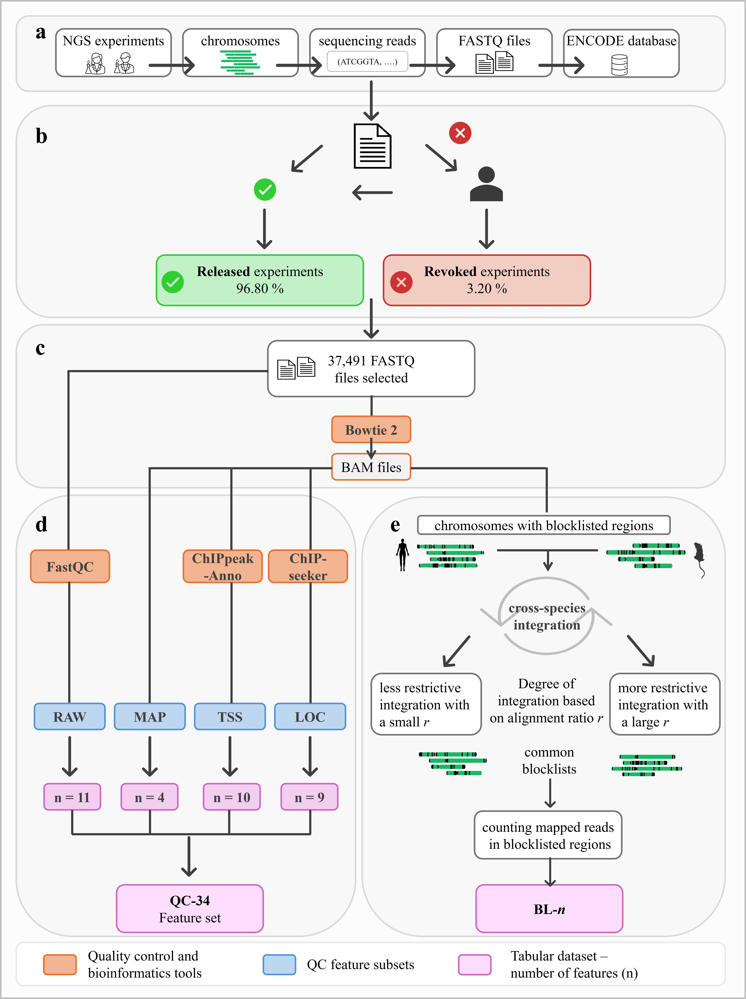

# An Imbalanced Dataset with Multiple Feature Sets for Studying Quality Control of Next-Generation Sequencing

This repository is the official implementation of [An Imbalanced Dataset with Multiple Feature Representations Describing the Quality of Selected Functional Genomics Assays](https://arxiv.org/abs/2604.04981). 


We generate feature sets that contain quality information to predict low-quality in functional genomics files, we provide a dataset of 37,491 RNA-seq, DNAse-seq, ChIP-seq and eCLIP files. 
We validate that the proposed features are related to sample quality. Therefore, we identify *revoked* samples based on their features using Random Forest classifiers with the default hyperparameters of the Python library scikit-learn.

## Requirements

#### To install requirements for the ML Experiments:

```setup
pip install -r experiments/requirements.txt
```

#### To install requirements for the feature generation:
```setup
conda env create -f bioinf.yml
```
By using the provided yml file, it is possible to create a conda environment with all dependencies and Bioconductor packages needed. The yml file also provides an overview of all dependencies with their versions.

It can be advisable to follow the more detailed step-by-step guides provided in the [seqQscorer README](https://github.com/salbrec/seqQscorer).

The easiest and fastest way to get ready for using the feature generation pipeline is pulling the seqQscorer docker image, running it and using the feature generation script within the docker.
For more details about how to use the docker image under Linux and Windows systems, we refer to the [seqQscorer README](https://github.com/salbrec/seqQscorer).

## Feature Validation
We validate that the proposed feature sets are related to sequencing quality and identify *revoked* samples based on their features in a supervised setting. We evaluated nine BL feature sets, generated using alignment ratios ranging from 0.1 to 0.9 in 0.1 increments. Each set had between eight and 1,183 features.  Echt dot shows the performance (mean AUC ROC/mean AUC PR) of the Random Forest classifiers after 10 runs. The square displays the performance of QC-34.

<p align = "center">
  
</p>
After running the script "supervised_feature_validation.py", you will receive the performance (AUC ROC mean ± standard deviation / AUC PR mean ± standard deviation) of Random Forest classifiers for all assay types on QC-34, and BL-n.  


## Feature Generation
The script `generate_QC_and_BL_features.py` has only one command line argument for the ENCODE accession of a raw sequencing file in FASTQ format. The pipeline autmoatically downloads this file into `./data/fastq/` and runs different tools and scripts to derive the different features. The result files from this will be saved under different directories in `./data/features/`. This is an example for creating all features for the QC-34, and BL-n datasets for the sample ENCFF001NAO from ENCODE: 
```
python generate_QC_and_BL_features.py ENCFF001NAO
```
The feature generation might be applied to multiple samples. To create the dataset containing the features for multiple NGS samples, the `gather_QC_and_BL_features.py` script can be used. It gathers all information from the different feature sets to assemble the QC-34, and BL-n datasets and create a comma-separated file for each of them.

## BL-n Generation
The script `generate_BL_dataset.py` creates a dataset with cross-species blocklists that come out with an alignment ratio between 0 and 1. The ratio defines the granularity of the dataset and the number of features (n) the BL dataset will contain. This is in an example for creating BL-1183 with alignment ratio 0.1 that contains 1,183 features: 
```
python generate_BL_dataset.py 0.1
```
The lineplot serves as inspiration. It shows the relationship between alignment ratio (x-axis) and number of features (y-axis).

![lineplot_ratio_features](https://github.com/user-attachments/assets/b7f99b5a-5


